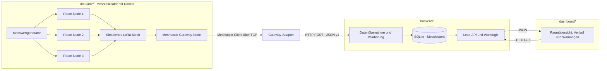

# H‑01 · Technische Architektur und Schnittstellen

Entwurf zur Teamfreigabe für [MES‑37](https://topocheckdiplomarbeit.atlassian.net/browse/MES-37). Grundlage ist der Repository-Stand auf `main` mit den Bereichen `simulator/`, `backend/` und `dashboard/`. Die Docker-Einrichtung mit einem virtuellen Knoten wurde bereits getestet. Das Diagramm zeigt den geplanten Ausbau.

## Architekturdiagramm



- Der **Messwertgenerator** erzeugt plausible CO₂-, Temperatur-, Feuchte- und Fensterwerte. Jeder virtuelle Raum-Node sendet seine Messdaten über das simulierte LoRa-Mesh. Drei Raum-Nodes und der Gateway-Node gehören zum Zielbild für H‑03. Die reale Funkdemo aus H‑04 kann über einen alternativen Geräteanschluss an denselben Gateway-Adapter angebunden werden. [H‑03](https://topocheckdiplomarbeit.atlassian.net/browse/MES-39) · [H‑04](https://topocheckdiplomarbeit.atlassian.net/browse/MES-40) · [H‑05](https://topocheckdiplomarbeit.atlassian.net/browse/MES-41)
- Der **Gateway-Adapter** gehört zu `simulator/`. Er liest empfangene Projektpakete über den Meshtastic-Client, ordnet Node-IDs den Räumen zu und übersetzt die Funkdaten in das HTTP-Format. Die genaue Funkcodierung legt H‑03 gemeinsam mit H‑05 fest.
- Das **Backend** prüft und speichert Messungen, liefert aktuelle und historische Werte und berechnet Warnungen zentral. Das **Dashboard** ruft diese Daten ab und zeigt pro Raum Werte, Verläufe und Warnungen an. [H‑06](https://topocheckdiplomarbeit.atlassian.net/browse/MES-42) · [H‑07](https://topocheckdiplomarbeit.atlassian.net/browse/MES-43) · [H‑09](https://topocheckdiplomarbeit.atlassian.net/browse/MES-45)

## Gemeinsames JSON-Datenformat v1

```json
{
  "schemaVersion": 1,
  "measurementId": "79ed8360-6341-4b35-b1e7-aa818837d776",
  "roomId": "5cn",
  "nodeId": "!00000010",
  "measuredAt": "2026-11-24T13:30:00Z",
  "co2Ppm": 980,
  "temperatureC": 22.4,
  "humidityPct": 45.2,
  "windowOpen": false
}
```

| Feld | Typ und Bedeutung |
| --- | --- |
| `schemaVersion` | Ganzzahl, für dieses Format genau `1` |
| `measurementId` | UUID als Zeichenkette, pro Messung eindeutig und bei jeder Wiederholung identisch |
| `roomId`, `nodeId` | Nicht leere Zeichenketten mit stabiler Raum-ID und Meshtastic-Node-ID |
| `measuredAt` | Messzeit als ISO‑8601-Zeitstempel in UTC mit `Z` |
| `co2Ppm` | Nicht negative Ganzzahl in ppm |
| `temperatureC` | Endliche Zahl in Grad Celsius |
| `humidityPct` | Zahl von 0 bis 100, relative Luftfeuchtigkeit in Prozent |
| `windowOpen` | Boolean, `true` für geöffnet und `false` für geschlossen |

Alle Felder sind Pflichtfelder. Der Gateway-Adapter verwendet die Messzeit und die stabile Messungsidentität aus der Quelle oder leitet die ID dauerhaft eindeutig aus Node-ID und quellseitiger Messungskennung ab. Beim Wiederholen desselben HTTP-Requests bleibt der gesamte Payload identisch.

## Gateway → Backend

`POST /api/v1/measurements` mit `Content-Type: application/json` nimmt genau ein Messobjekt entgegen.

| Status | Verhalten |
| --- | --- |
| `201 Created` | Messung gespeichert. Antwort enthält `{"measurementId":"…"}`. |
| `200 OK` | Identische Messung bereits gespeichert. Antwort enthält dieselbe ID. |
| `400 Bad Request` | JSON, Pflichtfelder, Werte, Raum-Node-Zuordnung oder Schema-Version ungültig. |
| `409 Conflict` | Dieselbe ID gehört bereits zu einem anderen Payload. |
| `503 Service Unavailable` | Speicherung vorübergehend nicht möglich. |

Fehlerantworten liefern `{"error":{"code":"invalid_measurement","message":"…"}}` mit passendem Fehlercode. Bei Timeout oder `5xx` kann der Adapter mit Wartezeit und derselben ID erneut senden. Bei `400` oder `409` protokolliert er den Fehler. SQLite speichert die Messungs-ID eindeutig und indiziert Raum und Messzeit.

## Backend → Dashboard

Das Dashboard verwendet HTTP-GET und JSON. Raum-IDs sind URL-kodiert. Das Backend liefert bei unbekannter Raum-ID `404` und bei ungültigem Zeitraum oder Limit `400` im gleichen Fehlerformat.

| Endpunkt | Antwort |
| --- | --- |
| `GET /api/v1/rooms` | `{"rooms":[{"roomId":"5cn","name":"5CN"}]}` aus der Raumkonfiguration |
| `GET /api/v1/rooms/{roomId}/latest` | `{"measurement": <Messobjekt oder null>, "alerts": []}` |
| `GET /api/v1/rooms/{roomId}/measurements?from=…&to=…&limit=…` | `{"measurements":[]}` mit Messobjekten, neueste zuerst |

`from` und `to` sind UTC-Zeitstempel. Das Intervall schließt `from` ein und `to` aus. Beide Parameter sind optional. `limit` ist optional, standardmäßig 100 und maximal 1000. Gleichzeitige Messungen werden nach Messungs-ID aufsteigend sortiert.

Ein aktiver Warnungseintrag hat die Form `{"type":"co2_high","since":"2026-11-24T13:30:00Z"}`. Die vorgesehenen Typen sind `co2_high` und `window_open_too_long`. Das Backend vergleicht den neuesten CO₂-Wert mit einem konfigurierbaren Grenzwert. Die Fensterdauer beginnt beim ersten offenen Messwert nach dem letzten geschlossenen Zustand oder beim ersten verfügbaren offenen Messwert. Sie wird ab der Messzeit berechnet. Ein geschlossener Messwert beendet die Warnung. Grenzwert und Dauer werden in H‑10 und H‑11 festgelegt. [H‑10](https://topocheckdiplomarbeit.atlassian.net/browse/MES-46) · [H‑11](https://topocheckdiplomarbeit.atlassian.net/browse/MES-47)

## Parallel entwickeln

- **Simulator:** Gateway-Ausgaben gegen einen lokalen HTTP-Testempfänger prüfen.
- **Backend:** Das JSON-Beispiel direkt an die POST-Schnittstelle schicken. Dieselbe Messung zweimal senden und genau einen gespeicherten Datensatz erwarten.
- **Dashboard:** Die GET-Antworten mit Beispieldaten nachbauen. Pro Raum auch leere Verläufe, `measurement: null` und aktive Warnungen darstellen.
- **Integration:** Drei Raum-Nodes und das Gateway starten. Einen Messwert vom virtuellen Node bis im Dashboard verfolgen und den historischen Abruf prüfen.

Die technischen Entscheidungen und die Teamfreigabe stehen im [Projektprotokoll](projektprotokoll.md).
